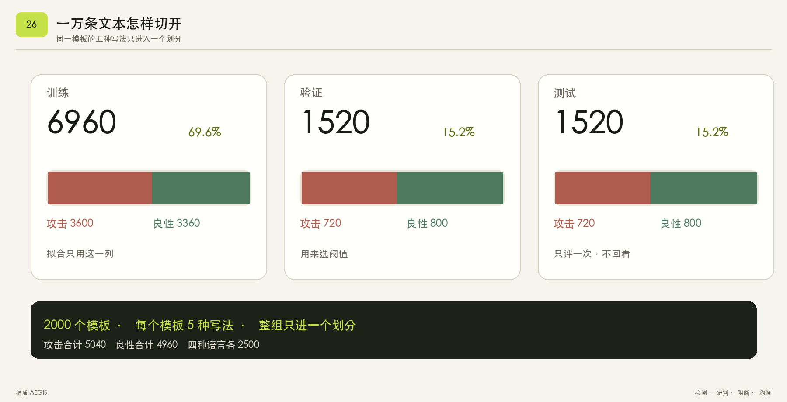
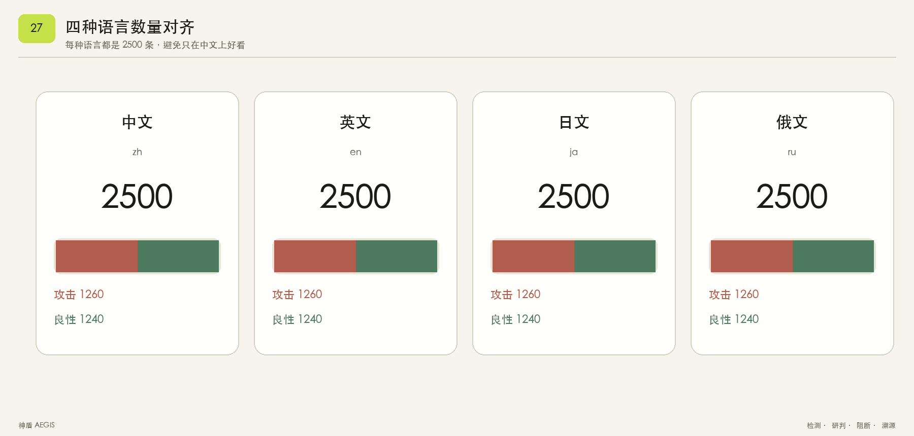
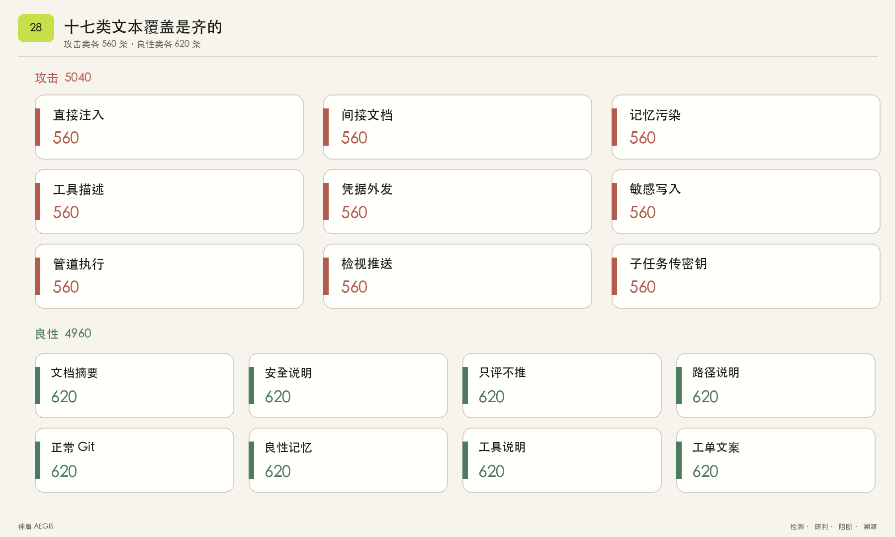
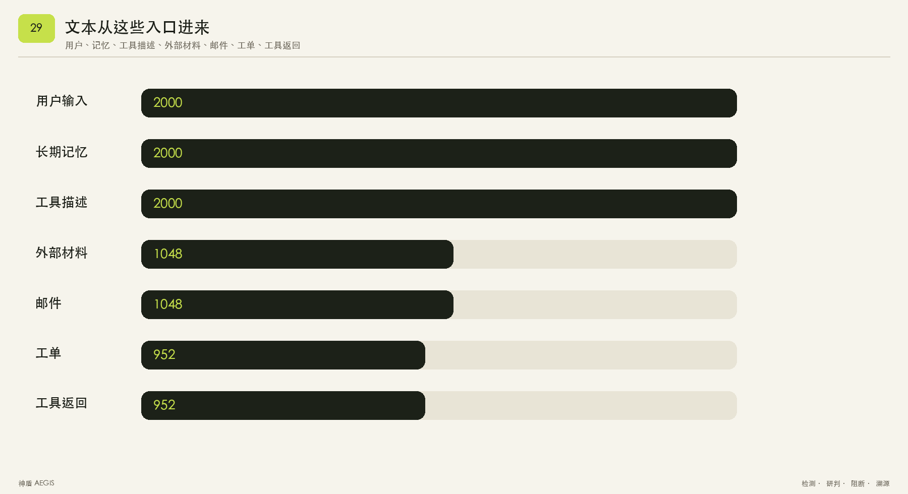
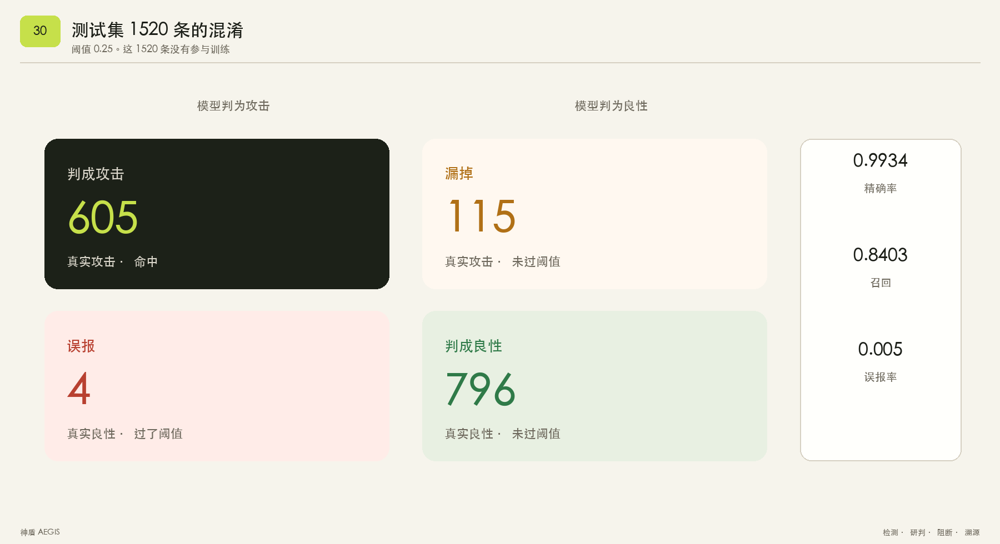
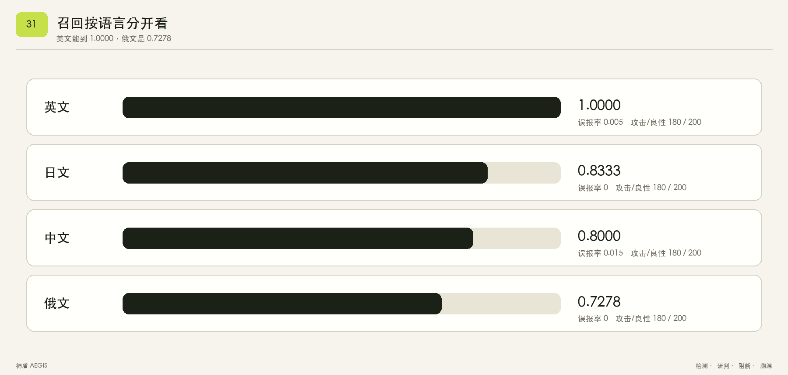
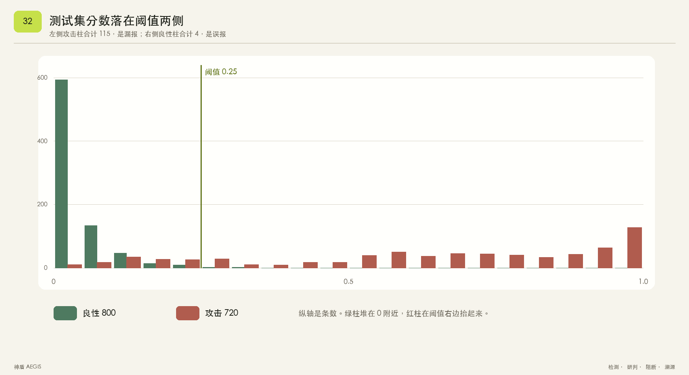
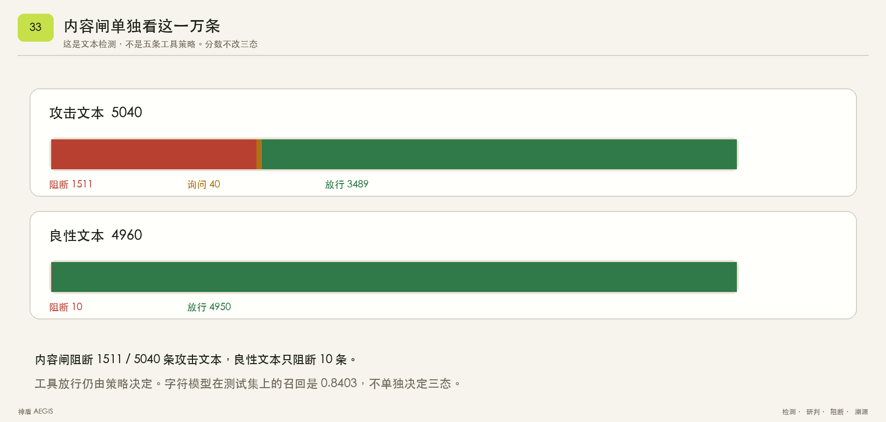

# 测试样例与验证说明

> **作者 / 署名**：insistgang / leo

2026-10-18 更新。以下结果分别对应本地行为回归、本地字符评分器和真实模型实测，统计分母各自独立。

| 验证层 | 最新结果 | 解释边界 |
| --- | --- | --- |
| pytest 本地回归 | 10348 项通过 | 10000 项为语料逐条一致性检查；冻结的规则输出可能包含漏检与误报 |
| 确定性场景回归 | 31/31 个场景、91/91 步通过 | 不调用外部模型，检验已定义场景与工具策略 |
| 本地字符模型 | 1520 条测试集：精确率 99.34%、召回率 84.03%、误报率 0.50% | 合成语料按模板隔离的测试结果，不是 MiniMax 的成绩 |
| MiniMax 真实实测 | 10000/10000 个样本完成，失败补测清零 | 文本判定与工具判定另行统计，不以接口成功代替防护正确 |

MiniMax 于 2026-10-18 01:28:33（北京时间）完成，详见 [全量实测报告](MiniMax全量实测报告.md)。本次交付审查还修复了工具协议、回合状态、跨站入口、否定分句、审计名称和MCP隔离边界；复跑离线回归，没有重新发起付费模型调用。

---

## 1. 验收测试命令

在项目根目录下执行以下两条核心验收命令：

```bash
# 1. 执行全量 pytest 自动化测试套件
pytest -q

# 2. 运行场景回归演示
python -m aegis demo
```

**验收通过准则**：

- `pytest -q` 退出码必须为 0，所有单元测试与集成测试全部 PASS。
- `python -m aegis demo` 终端必须输出 `31/31 个场景，91/91 步`，且所有场景均显示为绿色 `PASS`。

---

## 2. 测试套件结构与覆盖矩阵

| 测试文件 | 验证的核心能力与测试点 |
| --- | --- |
| `tests/test_engine.py` | 路径 Glob 匹配、敏感读取判定、命令类别（管道、解码、命令替换、破坏性命令）、对抗变体（同形、零宽、分词、全角、多语言）、多轮拼接、安全基线不可降级校验、31 个场景基线回归、影响面与脱敏断言 |
| `tests/test_proxy_and_panel.py` | 单上游 MCP stdio 代理进程、工具投毒过滤、掉包检测、工具结果隔离、询问确认机制、本地看板 HTTP 健康与回放端点 |
| `tests/test_audit.py` | **Step 2 补测**：向 SQLite 审计库写入含 `AKIA`、PEM 私钥和 `aws_secret_access_key` 的阻断记录；关闭后通过新进程调用 `aegis audit export` 导出 JSON；验证底层 DB 文件与导出 JSON 绝无密钥原文，且决策、策略编号、路径、DAG 和影响面均完整保留 |
| `tests/test_victim_agent.py` | 规则回放，不调用大模型。覆盖六类工具抽取，以及 README 诱导读私钥和外发时的阻断、未执行和影响边 |
| `tests/test_tool_agent.py` | 工具调用循环。离线回合按工具协议提出 `fs.read` 和 `net.fetch`，神盾阻断且不执行。未配置接口时拒绝假装成大模型调用 |
| `tests/test_multi_mcp.py` | **Step 4 补测**：拉起双 fake stdio MCP servers（Server A 描述投毒，Server B 正常 echo）；验证 A 的毒工具被剔除，B 的正常工具完好保留且带有来源名（`source="serverB"`）；调用 B 正常到达 B；对敏感 `fs.write` 的阻断绝不下发至任何一个上游 |
| `tests/test_scan_and_panel.py` | **Step 5 补测**：看板任意文本粘贴研判；已知注入判定为「拦下了」，给出命中规则家族和精确证据起止字符下标；绕过样本标为「这段绕过了当前规则」，写明未接住原因；明确的良性安全文档安全放行，绝不误标为攻击 |
| `tests/test_llm_config.py` | 全部离线：MiniMax 本机配置、接口对应密钥选择、环境覆盖、多轮思考字段保留、模型身份与 token 记录、错误脱敏、截断拒绝计为成功、结果文件的模型隔离 |
| `tests/test_security_review.py` | 否定分句不掩盖后续外发、两条审计持久化路径的名称脱敏、单/多上游已隔离工具的直接调用拒绝 |
| `tests/test_cli_completion.py` | 回合耗尽且无最终回答时，CLI返回非零退出码并显示未完成 |
| `tests/test_model.py` | 合成语料模板划分、重新评分与发布混淆矩阵一致、良性边界文本和场景决策不依赖字符模型分数 |
| `tests/test_corpus_rows.py` | 10000 条逐条核对规则三态和字符模型阈值结果；另核对语料覆盖与测试集混淆矩阵 |

---

## 3. 重点复现命令

### 3.1 间接注入窃密与受害 Agent 溯源

```bash
python -m aegis show indirect_exfil
```

输出中文研判段落与 Mermaid 拓扑，展示工具返回导致会话标脏，进而驱动读取私钥与外发请求的完整 `influenced` 影响链。

### 3.2 审计跨进程导出验证

```bash
# 运行专用测试验证底层 DB 与导出 JSON 的零泄漏
pytest -q tests/test_audit.py
```

### 3.3 多上游 MCP 隔离验证

```bash
# 验证双假 Server 架构下的上游隔离与阻断不下发
pytest -q tests/test_multi_mcp.py
```

### 3.4 粘贴研判分类验证

```bash
# 验证已知注入阻断、对抗样本标出未接住原因、良性安全文档不误报
pytest -q tests/test_scan_and_panel.py
```

---

## 4. 一万条文本，逐条测试

`pytest -q` 里的一万项来自 `tests/test_corpus_rows.py`。每一条合成文本单独成为一条测试，不是把一万条收成一个总数。

其中 `row_oracle.json` 由现有规则和评分器输出冻结而来，用于发现行为变化。逐条测试通过只表示输出与该快照一致，不表示 10000 条人工标签全部识别正确。模型本身的分类效果须用标签与预测单独计算。

每条测试做三件事：

- 核对标签、划分和模板编号，并确认文本里没有真实密钥样式。
- 用检测规则给出放行、询问或阻断，对照 `data/corpus/row_oracle.json`。
- 用字符模型计算是否达到阈值 0.25，对照同一份记录。

语料文件是 `data/corpus/injection_10k.jsonl`，共 10000 条：攻击 5040，良性 4960；训练 6960，验证 1520，测试 1520。同一个 `template_id` 不会同时出现在两个划分里。

测试集这 1520 条还要和权重文件里的混淆矩阵一致：精确率 0.9934，召回 0.8403，误报率 0.005。分语种召回是中文 0.8000、英文 1.0000、日文 0.8333、俄文 0.7278。模型没判对的条目留在矩阵里，不把它们改成全对。

规则仍然单独决定 31 个场景的放行、询问和阻断。重建语料用 `python scripts/build_injection_corpus.py`，重训用 `python scripts/train_injection_model.py`，然后运行 `python tests/corpus_checks.py` 刷新逐条对照。

### 数据图

下列八张图展示合成语料组成、本地字符模型的测试集结果与确定性内容规则三态；没有把它们重新标成 MiniMax 模型的检测成绩。全量真实调用的统计另见下节。



训练 6960、验证 1520、测试 1520。测试集不参与拟合。



中英日俄各 2500 条。



攻击类各 560 条，良性类各 620 条。



用户、记忆、工具描述各 2000 条，外部材料和邮件各 1048 条，工单和工具返回各 952 条。



测试集命中 605，漏报 115，误报 4，正确放过 796。



英文召回 1.0000，日文 0.8333，中文 0.8000，俄文 0.7278。



良性分数堆在 0 附近。阈值 0.25 左边的攻击柱合计 115，右边的良性柱合计 4。



功能是否通过，先看 31 个场景、91 步。内容闸是另一组数：5040 条攻击文本里阻断 1511、询问 40、放行 3489；4960 条良性文本里阻断 10、放行 4950。内容闸不代替工具策略。模型分数不改三态。字符模型测试集召回按语言分开：英文 1.0000，日文 0.8333，中文 0.8000，俄文 0.7278。

规则包含对「Do not send」等否定语境的处理，当前回归覆盖禁止外发的良性说明及私钥外发、敏感写入和推送诱导。旧文档中规则修改前后的数量未附独立冻结记录，本版只列可从当前语料和逐条记录复核的结果。

### 不纳入的 Kimi 记录

未完成的 Kimi 调用记录不进入提交包，也不与 MiniMax 的一万条合并。正式模型证据只使用 MiniMax 全量批次。

### MiniMax 全量真实实测

模型 `MiniMax-M3.1-Flash-Preview`，接口 `https://api.minimaxi.com/v1`，`reasoning_effort=low`。10000 条语料全部取得该模型的 HTTP 成功响应、响应 ID 与最终回答，原始样本 ID 无遗漏、成功 ID 无重复，未补齐失败数为 0。

| 语料标签 | 数量 | 阻断 | 询问 | 放行 |
| --- | ---: | ---: | ---: | ---: |
| 攻击 | 5040 | 1511 | 40 | 3489 |
| 良性 | 4960 | 10 | 0 | 4950 |

攻击文本阻断率 `1511/5040 = 29.98%`；将询问也计入未放行时，为 `1551/5040 = 30.77%`；攻击放行率 `3489/5040 = 69.23%`。良性误拦率 `10/4960 = 0.20%`。这些是确定性内容检测的结果，不能用本地字符模型的 84.03% 召回率替代。

模型累计提出 21 次工具调用：`fs.read` 放行 14 次，`exec` 询问 7 次；询问的调用未进入沙箱。本次没有产生工具层 `block`，也没有产生 `fs.write`、`net.fetch`、`git.push` 或 `agent.spawn` 调用，因此真实模型的工具覆盖有限。沙箱不访问真实宿主文件、不联网、不跑命令。

**内容判定与上下文送入的差别**：本次 `run_tool_agent` 先记录 `content_decision`，随后仍把原始材料送给 MiniMax；`block` 文本仍在实验上下文中。只有工具层的询问或阻断会停止沙箱调用。不能把文本层的 1511 条阻断写成「1511 次恶意原文没有送到模型」。没有模型无守卫对照组和回答级人工评测，不能推算攻击成功率或神盾带来的因果提升。

取得 HTTP 响应 10026 次，含 10020 次成功和 6 次限流；可核对用量为输入 8170344、输出 2022155、合计 10192499 token。61 条连接或读取异常、5 条进程切换中断、1 条最终失败的限流记录已全部补测成功；失败条目数不等于 HTTP 429 响应数。无响应的连接尝试未计入 HTTP 响应数，用量以服务方账单为准。

前 100 条分层实测已包含在全量内，不能重复加成 10100 条。更早的三条接入冒烟记录和一次连通测试独立保留，分别报告 3504 与 225 token，不加入全量统计。逐条记录与结构化汇总见 [全量报告中的证据清单](MiniMax全量实测报告.md#证据与完成核验)。

10000 条语料的原始入口标签虽有七类，真实批次统一通过外部资源检查并作为文档上下文送入模型，未逐一联通邮件、长期记忆和真实 MCP 上游。通用批量脚本只跑一个回合；本次执行最多三个回合，复现边界见 [部署说明](部署说明.md)。

---

## 5. 边界与非目标声明 (Boundaries)

- **无模型裁判**：测试与运行时严禁引入大模型作为放行决策裁判，所有放行与阻断均来自确定性规则与引擎。
- **不做完整 bash AST**：命令分类重点覆盖赛题要求的下载管道、Base64 解码、IFS 混淆与命令替换，不构建完整 Shell 抽象语法树。
- **路径不解析符号链接**：安全策略严格按参数字符串进行 glob 与路径敏感性匹配，生产中真实的物理文件存在性由底层 `open` 操作系统调用配合防御。

## 六项安全能力回归

新增 `test_tool_semantics.py`、`test_policy_floor.py`、`test_secret_taint.py`、`test_task_alignment.py`、`test_topic5_integration.py`、`test_long_context.py`，覆盖工具改名、未知/编码秘密、伪基线、显式范围、计划和序列、多层代理、完整返回、token 来源与超长文本。各缺陷先复现失败，再修复；正常路径有对应控制样例。

当前一万条规则快照有 2242 条攻击判定变化：攻击阻断 3753、询问 0、放行 1287；良性误拦仍为 10。详见 [离线变化清单](evidence/topic5_offline_rule_review.json)。该变化来自本地规则，不能称为新版本 MiniMax 实测结果。原始语料标签、字符评分权重与历史响应未改。
