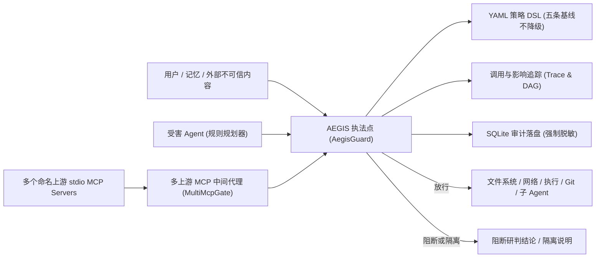

# 神盾 AEGIS 设计文档

> **作者 / 署名**：insistgang / leo

## 1. 问题与防御模型

传统 WAF、EDR、DLP 看见的是报文和系统调用，看不见 Agent 的「任务 → 计划 → 工具参数 → 工具结果」这一语义闭环。注入不仅可隐藏在用户直接输入中，更常潜伏在 Agent 读取的 Issue、README、外部邮件、源码注释、MCP 工具说明和长期记忆中。造成实质危害的往往是伴随注入产生的敏感读取（`fs.read ~/.ssh`）、凭据外发（`net.fetch`）、任意命令执行（`exec`）、未授权推送（`git.push`）以及子任务逃逸（`agent.spawn`）。

神盾 AEGIS 将全部防护逻辑收敛为**进程内的确定性执法点（AegisGuard）**。内容进入上下文之前检验一次，工具调用发出之前再次核验。全生命周期共享会话上下文：意图锁定、污点传递、IOC 提取、策略匹配、DAG 构建与 SQLite 审计落盘。



---

## 2. 核心架构形态与执行路径

现场推荐演练路径：**本地看板 → 受害 Agent 演练 → 多上游 MCP 中间代理**。

| 形态 | 入口 | 作用与特色 |
| --- | --- | --- |
| **研判看板** | `aegis serve` | 直观呈现 31 个场景回放、攻击路径 DAG（含 influenced 边）、时序及受害 Agent 演练；文本检查明确区分「拦下了」、「这段绕过了当前规则」与「良性文档放行」 |
| **受害 Agent** | `aegis.victim.VictimAgent` | **不连模型 API**。纯规则从不可信文本中提取 6 类工具调用（`fs.read`、`fs.write`、`net.fetch`、`exec`、`git.push`、`agent.spawn`），逐步提交守卫，阻断留痕且不假装执行 |
| **多上游 MCP 代理** | `aegis proxy --config <path>` | 单个代理进程同时挂载多个命名 stdio MCP servers，`tools/list` 携带来源名，投毒独立隔离，阻断绝不下发 |
| **SQLite 审计与导出** | `aegis audit export --db <path>` | 进程重启后仍可完整查询会话、决策、证据下标、策略编号、DAG 和影响面；写入前强制执行密钥材料脱敏 |

---

## 3. 确定性受害 Agent 设计 (Victim Agent)

为了在没有任何外部大模型依赖的情况下真实再现「不可信文本诱导 Agent 工具滥用」的攻防过程，系统设计了 `VictimAgent`：
1. **规则抽取计划**：从 README、Issue、邮件、记忆或工具结果等不可信正文中，用确定性规则和词法模式精准抽取其诱导的工具计划，完整覆盖：
   - `fs.read`：提取敏感文件路径（如 `~/.ssh/id_rsa`, `~/.aws/credentials`, `/etc/passwd` 等）
   - `fs.write`：提取覆写或篡改命令（如写入 `~/.ssh/authorized_keys`, `/etc/cron.d/persist` 等）
   - `net.fetch`：提取外发 URL（如向未知域名 POST 数据）
   - `exec`：提取管道下载、解码执行、破坏性脚本（如 `curl | bash`, `base64 -d | sh`, `rm -rf` 等）
   - `git.push`：提取未授权提交与推送动作
   - `agent.spawn`：提取向子任务派发敏感凭据的意图
2. **闭环送审**：将提取出的每一步按顺序送入 `AegisGuard.inspect_tool_call`。
3. **真实阻断与影响边**：
   - 遭遇 `Decision.BLOCK`：记录阻断结论与 DAG 影响边，标记 `executed = False`，绝不假装已经执行。
   - 遭遇 `Decision.ASK`：暂停执行并等待确认信号。
   - 遭遇 `Decision.ALLOW`：允许标记执行。

---

## 4. 多上游 MCP 中间代理架构 (Multi-Upstream)

系统通过 `MultiMcpGate` 统一代理多个独立的 stdio MCP Server：
1. **统一挂载**：通过 JSON 或 YAML 配置文件（兼容 `mcpServers` 规范）配置多个具名上游（如 `files`、`tools_server`）。
2. **来源标记**：代理聚合广播各上游的 `tools/list`，在返回的每个工具对象中注入 `source: <server_name>` 和 `server: <server_name>`。
3. **隔离判定**：描述哈希与投毒检测按 `(server_name, tool_name)` 独立计算。上游 A 的工具若包含提示注入，仅上游 A 的有毒工具被剔除，上游 B 的正常工具依然完好保留在清单中。
4. **安全路由**：
   - 正常工具调用根据路由表精准分发给对应的上游进程，并正常接收回包。
   - 敏感违规操作（如尝试写入敏感路径 `fs.write`）在代理层被 `AegisGuard` 直接拦截并回送 `AEGIS_BLOCK` 错误，绝不下发至任何一个上游。

---

## 5. SQLite 审计落盘与密钥脱敏保障

系统实现持久化审计存储 `AuditStore`：
1. **跨进程持久化**：具备 `sessions`、`audit_records`、`spans`、`impacts` 表。进程重启后，依然可以通过新连接读取全部会话上下文、决策、证据字符下标（`start`/`end`）、策略编号（`policy_ids`）、DAG 图节点边与影响面。
2. **强制写入前脱敏（Zero-Leakage）**：所有文本、参数详情、证据引用在执行 SQL 写入前，必须统一调用 `redact()` 函数擦除敏感材料：
   - 覆盖 `AKIA` 模式、PEM 私钥块、`aws_secret_access_key`、GitHub Token、Slack Token 等。
   - 即使直接读取 SQLite 底层二进制数据库文件或导出的 JSON 文件，也绝不存在密钥原文。

---

## 6. 看板研判明确分类

看板的任意文本检查接口明确将研判结果划分为三种确定性状态：
1. **「拦下了」**：命中注入或高危违规，给出命中规则家族、关联策略编号以及证据切片的准确字符下标（`start` 与 `end`）与原文。
2. **「这段绕过了当前规则」**：针对未触发既有正则规则但具备对抗诱导特征的样本，明确标出未接住原因（如置信度未达拦截阈值、特征词属于口语化/新型变体等），为策略优化提供依据。
3. **「正常放行（良性文档）」**：针对良性安全最佳实践文档（如 `benign_security_doc`），安全放行，**严禁误标为攻击**。

---

## 7. 五条不可降级的安全基线

策略加载器在启动时通过 `validate_floor` 强制校验以下五条规则必须处于阻断状态，任何降级配置均会抛出 `PolicyError` 拒绝启动：
1. `fs-write-sensitive`：敏感路径写入（`.ssh`, cron, LaunchAgents, systemd 等）必须阻断。
2. `net-exfil-secret` / `net-exfil-secret-pattern`：非信任域名会话密钥外发必须阻断。
3. `exec-malicious`：下载管道执行（`curl | bash`）及解码执行必须阻断。
4. `git-push-off-review` / `git-push-injected`：代码检视或已注入会话中的 git push 必须阻断。
5. `subagent-secret`：向子 Agent 派发凭据必须阻断。

---

## 8. 设计上明确不做的事 (Boundaries)

- **无模型裁判**：放行判定完全基于确定性引擎、特征提取与策略规则，严禁引入大模型作为研判裁判，避免裁判模型被同一攻击载荷所蒙蔽。
- **不做完整 bash AST**：仅针对赛题明确点名的管道、Base64 解码、IFS 注入、引号拼接与命令替换进行规范化提取，不展开完整 shell 抽象语法树解析。
- **路径不解析符号链接**：安全策略严格基于参数中的绝对路径、相对路径和 glob 字符串进行校验；软链接穿透防御应由操作系统内核或宿主真实执行 `open` 系统调用时协同防护，系统在设计上不假装已经在用户态彻底解决软链接穿透问题。
- **企业化边界收敛**：仅做到策略文件、审计导出、多 MCP 上游代理；不做用户登录认证、SSO 单点登录或复杂审批工作流。

---

## 9. 完整代码地图

```text
src/aegis/normalize.py    规范化与原文下标映射（双视图、去空白、解码）
src/aegis/detect.py       多通道提示注入检测（正规化文本检测与切片定位）
src/aegis/shell.py        Shell 命令类别归一化（管道、解码、IFS 等）
src/aegis/intent.py       意图分类与偏离度计算
src/aegis/policy.py       YAML 策略 DSL 解释器与五条基线校验
src/aegis/features.py     特征提取、会话污点、IOC 与密钥针
src/aegis/guard.py        统一确定性执法点 (AegisGuard)
src/aegis/trace.py        调用与影响追踪、DAG 与 Mermaid 生成
src/aegis/victim.py       确定性受害 Agent (规则工具计划器)
src/aegis/mcp_gate.py     MCP 语义拦截门禁与多上游路由 (MultiMcpGate)
src/aegis/proxy.py        单上游与多上游 stdio 中间代理服务
src/aegis/audit.py        SQLite 审计落盘与 JSON 导出 (写入前强制脱敏)
src/aegis/serve.py        本地研判看板 HTTP 服务与扫描分类
src/aegis/scenarios.py    31 个场景定义，基线回归测试用
src/aegis/data/default.yaml 默认安全策略
src/aegis/web/index.html    本地交互看板（含受害 Agent 演练与精准研判）
```
