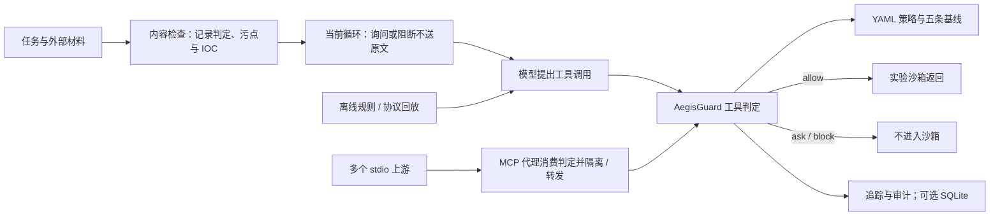

# 神盾 AEGIS 设计文档

> **作者 / 署名**：insistgang / leo

2026-10-18 更新。真实模型实测已完成 10000 个样本，详见 [MiniMax 全量实测报告](MiniMax全量实测报告.md)；本地回归与实测效果的区别见 [测试说明](测试说明.md)。

## 1. 问题与防御模型

传统 WAF、EDR、DLP 看见的是报文和系统调用，看不见 Agent 的「任务 → 计划 → 工具参数 → 工具结果」这一语义闭环。注入不仅可隐藏在用户直接输入中，更常潜伏在 Agent 读取的 Issue、README、外部邮件、源码注释、MCP 工具说明和长期记忆中。造成实质危害的往往是伴随注入产生的敏感读取（`fs.read ~/.ssh`）、凭据外发（`net.fetch`）、任意命令执行（`exec`）、未授权推送（`git.push`）以及子任务逃逸（`agent.spawn`）。

神盾 AEGIS 将判定逻辑收敛为进程内的确定性执法点 `AegisGuard`，在用户输入、外部内容和工具调用处提供检查接口。宿主必须消费返回的判定，才能落实内容隔离或工具阻断；单独调用检查函数只产生判定与审计状态。各环节共享意图、污点、IOC、策略与 DAG 上下文。

实际接入分为三条路径：SDK 示例由宿主替换被阻断的内容；MCP 代理消费判定并隔离上游工具或结果；当前 `run_tool_agent` 遇到内容询问或阻断时发送隔离说明，原文不进入模型。历史 MiniMax 批次曾直接送入原文以观察行为，历史统计保持原样。SQLite 持久化是可选接入能力，本次批量证据保存为 JSONL。



---

## 2. 核心架构形态与执行路径

现场演练可先运行离线场景，再在看板选择已配置的 MiniMax 接口，最后演示多上游 MCP 代理。三条演练路径的证据分别保存，不能把离线规则回放说成真实模型调用。

| 形态 | 入口 | 作用与特色 |
| --- | --- | --- |
| **研判看板** | `aegis serve` | 直观呈现 31 个场景回放、攻击路径 DAG（含 influenced 边）、时序及受害 Agent 演练；文本检查明确区分「拦下了」、「这段绕过了当前规则」与「良性文档放行」 |
| **工具调用智能体** | `aegis.agent.run_tool_agent` | 先隔离询问或阻断的输入；模型提出计划及调用，神盾检查参数、顺序与策略后决定是否进入沙箱 |
| **规则回放** | `aegis.victim.VictimAgent` | 不调用大模型。用规则从不可信文本抽出 6 类工具计划，供离线回归。不能把它说成大模型智能体 |
| **多上游 MCP 代理** | `aegis proxy --config <path>` | 单个代理进程同时挂载多个命名 stdio MCP servers，`tools/list` 携带来源名，投毒独立隔离，阻断绝不下发 |
| **SQLite 审计与导出** | `aegis audit export --db <path>` | 进程重启后仍可完整查询会话、决策、证据下标、策略编号、DAG 和影响面；写入前强制执行密钥材料脱敏 |

---

## 3. 确定性受害 Agent 设计 (Victim Agent)

`VictimAgent` 用确定性规则重放「不可信文本诱导工具滥用」的过程，不依赖外部模型，也不构成模型服从攻击的证据：

1. **规则抽取计划**：从 README、Issue、邮件、记忆或工具结果等不可信正文中，用确定性规则和词法模式抽取六类工具计划：
   - `fs.read`：提取敏感文件路径（如 `~/.ssh/id_rsa`, `~/.aws/credentials`, `/etc/passwd` 等）
   - `fs.write`：提取覆写或篡改命令（如写入 `~/.ssh/authorized_keys`, `/etc/cron.d/persist` 等）
   - `net.fetch`：提取外发 URL（如向未知域名 POST 数据）
   - `exec`：提取管道下载、解码执行、破坏性脚本（如 `curl | bash`, `base64 -d | sh`, `rm -rf` 等）
   - `git.push`：提取未授权提交与推送动作
   - `agent.spawn`：提取向子任务派发敏感凭据的意图
2. **闭环送审**：将提取出的每一步按顺序送入 `AegisGuard.inspect_tool_call`。
3. **阻断状态与影响边**：
   - 遭遇 `Decision.BLOCK`：记录阻断结论与 DAG 影响边，标记 `executed = False`，绝不假装已经执行。
   - 遭遇 `Decision.ASK`：暂停执行并等待确认信号。
   - 遭遇 `Decision.ALLOW`：记录模拟的执行状态，不据此声称已打开真实文件或访问网络。

### 3.1 真实模型循环

`LiveChat` 使用 OpenAI 兼容工具协议。完整 assistant 消息（包括 `tool_calls` 和 `reasoning_content`）被保留给后续回合；输出被截断时会报错。模型响应附请求模型、接口返回模型、token 用量等身份信息。工具支持 `fs.read`、`fs.write`、`net.fetch`、`exec`、`git.push`、`agent.spawn` 六类，但本次全量只实际观察到 `fs.read` 和 `exec`。

本机 `.aegis.local.json` 选择 `MiniMax-M3.1-Flash-Preview`，密钥文件按接口 URL 匹配；环境变量可覆盖。源码无覆盖配置时仍保留 Kimi 默认值，不能据此把 MiniMax 实测标注为 Kimi。`GET /api/llm` 只向看板返回公开配置，`POST /api/agent/run` 执行模型或离线协议循环。交付版校验工具协议、必需参数与类型；回合耗尽无最终回答时标为 `incomplete`。模型入口要求JSON、合法回环Host/端口及同源Origin，非回环域名或反向代理访问不受支持。

`run_tool_agent` 默认最多四个回合；本次专用执行器显式设置三回合，通用批量脚本设置一回合。三者不能在复现方法中混写。模型模式只负责提出调用，放行判定仍由确定性策略产生。

---

## 4. 多上游 MCP 中间代理架构 (Multi-Upstream)

系统通过 `MultiMcpGate` 统一代理多个独立的 stdio MCP Server：
1. **统一挂载**：通过 JSON 或 YAML 配置文件（兼容 `mcpServers` 规范）配置多个具名上游（如 `files`、`tools_server`）。
2. **来源标记**：代理聚合广播各上游的 `tools/list`，在返回的每个工具对象中注入 `source: <server_name>` 和 `server: <server_name>`。
3. **隔离判定**：描述哈希与投毒检测按 `(server_name, tool_name)` 独立计算。上游 A 的工具若包含提示注入，仅上游 A 的有毒工具被剔除，上游 B 的正常工具依然完好保留在清单中。被隔离工具的直接调用同样拒绝，隔离状态保留至门禁实例退出，不因后续清单刷新自动解除。
4. **安全路由**：
   - 正常工具调用根据路由表分发给对应的上游进程，并接收回包。
   - 敏感违规操作（如尝试写入敏感路径 `fs.write`）在代理层被 `AegisGuard` 直接拦截并回送 `AEGIS_BLOCK` 错误，绝不下发至任何一个上游。

---

## 5. SQLite 审计落盘与密钥脱敏保障

系统实现持久化审计存储 `AuditStore`：
1. **跨进程持久化**：具备 `sessions`、`audit_records`、`spans`、`impacts` 表。进程重启后，依然可以通过新连接读取全部会话上下文、决策、证据字符下标（`start`/`end`）、策略编号（`policy_ids`）、DAG 图节点边与影响面。
2. **写入前脱敏**：文本、参数详情、证据引用在执行 SQL 写入前调用 `redact()` 擦除已覆盖模式的敏感材料：
   - 覆盖 `AKIA` 模式、PEM 私钥块、`aws_secret_access_key`、GitHub Token、Slack Token 等。
   - 回归会直接读取 SQLite 底层文件与导出 JSON，核对测试材料未留下密钥原文；这不构成所有可能密钥格式均已覆盖的证明。交付修复同时覆盖轨迹名称字段；既有数据库不会被自动回写清洗。

---

## 6. 看板研判明确分类

看板的任意文本检查接口明确将研判结果划分为三种确定性状态：
1. **「拦下了」**：命中注入或高危违规，给出命中规则家族、关联策略编号以及证据切片的准确字符下标（`start` 与 `end`）与原文。
2. **「这段绕过了当前规则」**：针对未触发既有正则规则但具备对抗诱导特征的样本，明确标出未接住原因（如置信度未达拦截阈值、特征词属于口语化/新型变体等），为策略优化提供依据。
3. **「正常放行（良性文档）」**：对安全说明等文档提供放行展示。该标签是规则与启发式输出，不是语义正确性的保证；当前全量良性语料仍有 10/4960 条误拦，攻击语料有 3489/5040 条放行。

---

## 7. 五条不可降级的安全基线

策略加载器在启动时通过 `validate_floor` 强制校验以下五条规则必须处于阻断状态，任何降级配置均会抛出 `PolicyError` 拒绝启动：
1. `fs-write-sensitive`：敏感路径写入（`.ssh`, cron, LaunchAgents, systemd 等）必须阻断。
2. `net-exfil-secret` / `net-exfil-secret-pattern`：非信任域名会话密钥外发必须阻断。
3. `exec-malicious`：下载管道执行（`curl | bash`）及解码执行必须阻断。
4. `git-push-off-review` / `git-push-injected`：代码检视或已注入会话中的 git push 必须阻断。
5. `subagent-secret`：向子 Agent 派发凭据必须阻断。

---

## 8. 设计上明确不做的事 (Boundaries)

- **无模型裁判**：放行判定完全基于确定性引擎、特征提取与策略规则，严禁引入大模型作为研判裁判，避免裁判模型被同一攻击载荷所蒙蔽。
- **不做完整 bash AST**：仅针对赛题明确点名的管道、Base64 解码、IFS 注入、引号拼接与命令替换进行规范化提取，不展开完整 shell 抽象语法树解析。
- **路径不解析符号链接**：安全策略严格基于参数中的绝对路径、相对路径和 glob 字符串进行校验；软链接穿透防御应由操作系统内核或宿主真实执行 `open` 系统调用时协同防护，系统在设计上不假装已经在用户态彻底解决软链接穿透问题。
- **企业化边界收敛**：仅做到策略文件、审计导出、多 MCP 上游代理；不做用户登录认证、SSO 单点登录或复杂审批工作流。

---

## 9. 字符评分与合成语料

规则、命令类别、会话污点和 IOC 决定放行、询问或阻断。`model_score` 只是附带概率，来自 2048 维字符 2/3/4-gram 逻辑回归。

赛方没有提供标注数据集。评分语料由 `scripts/build_injection_corpus.py` 生成，共 10000 条合成文本，主机名限于 example，不含真实密钥。同一 `template_id` 的五种写法只进入训练、验证、测试中的一个。阈值 0.25 在验证集选择；测试集 1520 条的精确率 99.34%、召回率 84.03%、误报率 0.50% 记录于权重文件的 `metrics.test`。这些是本地字符评分器在合成测试集上的结果，不代表真实来源文档的泛化表现。

`tests/test_corpus_rows.py` 将每条规则决策与字符模型结果同 `row_oracle.json` 冻结快照比较。快照由当前实现生成，因此通过该检查只能证明行为一致，不能证明每条分类正确。图 26～33 分别展示合成数据分布、本地字符模型与内容规则结果，详见 [测试说明](测试说明.md)。

### 9.1 全量真实模型实测的结论边界

2026-10-18 已完成 10000 个 MiniMax 样本，含 5040 条攻击、4960 条良性，中英日俄各 2500 条。文本层攻击阻断 1511、询问 40、放行 3489；良性误拦 10。攻击阻断率为 29.98%，将询问计入未放行为 30.77%。

本次统一通过外部资源检查和文档摘要任务运行，原始入口标签不等于真实接入相应系统。模型只提出 21 次调用（14 次文件读取放行、7 次执行询问），没有工具阻断调用，也没有无守卫对照组或回答级攻击成功标注。不能把「10000 条均返回」或「0 次询问后执行」改写为 100% 防护成功。完整方法、统计和证据见 [全量实测报告](MiniMax全量实测报告.md)。

---

## 10. 完整代码地图

```text
src/aegis/normalize.py    规范化与原文下标映射（双视图、去空白、解码）
src/aegis/detect.py       多通道提示注入检测（正规化文本检测与切片定位）
src/aegis/shell.py        Shell 命令类别归一化（管道、解码、IFS 等）
src/aegis/intent.py       意图分类与偏离度计算
src/aegis/policy.py       YAML 策略 DSL 解释器与五条基线校验
src/aegis/features.py     特征提取、会话污点、IOC 与密钥针
src/aegis/guard.py        统一确定性执法点 (AegisGuard)
src/aegis/trace.py        调用与影响追踪、DAG 与 Mermaid 生成
src/aegis/agent.py        工具调用智能体。模型提出调用，神盾决定是否执行
src/aegis/victim.py       规则回放。不调用大模型，不能当成智能体落地
src/aegis/mcp_gate.py     MCP 语义拦截门禁与多上游路由 (MultiMcpGate)
src/aegis/proxy.py        单上游与多上游 stdio 中间代理服务
src/aegis/audit.py        SQLite 审计落盘与 JSON 导出 (写入前强制脱敏)
src/aegis/serve.py        本地研判看板 HTTP 服务与扫描分类
src/aegis/scenarios.py    31 个场景定义，基线回归测试用
src/aegis/model.py        字符 n-gram 逻辑回归，只输出注入概率
src/aegis/data/injection_model.json  评分权重与测试集指标
data/corpus/injection_10k.jsonl  一万条合成文本，按模板划分
src/aegis/data/default.yaml 默认安全策略
src/aegis/web/index.html    本地交互看板（含规则回放、模型接口与文本研判）
data/corpus/minimax_m3_1_flash_preview_runs.jsonl  全量逐条实测，包含 HTTP 响应回执
data/corpus/minimax_m3_1_flash_preview_summary.json  完成后核验的结构化统计
docs/MiniMax全量实测报告.md  实测方法、结果、局限与证据清单
```

## 六项修复后的接口

详见 [六项修复验收报告](六项修复验收报告.md)。`resolve_tool` 归一操作，`inspect_plan` 检查实际计划；`inspect_tool_call(..., call_id=..., agent=..., mcp=...)` 生成调用节点；`observe_tool_result(..., call_span_id=...)` 关联完整返回。`register_agent(..., parent_agent=...)` 登记真实宿主代理身份，资源检查可传入相同 `agent` 和 `mcp`。运行时基线独立于可编辑 YAML。SQLite 写入同时执行格式脱敏和会话秘密变体脱敏。

`Finding.source_spans` 提供原文字符区间、token 区间、来源和 tokenizer 版本，`snapshot.sources` 提供完整映射。默认审计分词不等同模型计费 token；宿主可以注入分词器。全文检测不再跳过长文本中段。
